<div align="center">


# RenderFlow

**Nanosecond-Precision Monotonic Frame Pacing, Thread Yield Elimination & Chunk Upload Time-Slicing for Minecraft 1.12.2**

[](https://minecraft.net/)
[](https://github.com/CleanroomMC)
[](https://github.com/Brilliafy/RenderFlow/releases)
[](LICENSE)
[](https://www.curseforge.com/minecraft/mc-mods/mixinbooter)
[](#-overview)

<p align="center">
  <a href="#-why-renderflow">Why RenderFlow?</a> •
  <a href="#-key-features">Key Features</a> •
  <a href="#-architecture-comparison">Architecture</a> •
  <a href="#-in-game-commands">Commands</a> •
  <a href="#-configuration">Configuration</a> •
  <a href="#-compatibility">Compatibility</a> •
  <a href="#-installation">Installation</a> •
  <a href="#-building-from-source">Building</a>
</p>

</div>

---

## 🌟 Why RenderFlow?

Even on modern high-end PCs, Minecraft 1.12.2 frequently suffers from micro-stuttering, uneven frame delivery, and sudden frame spikes when moving through the world. These hitches are caused by three legacy design bottlenecks in the vanilla client render loop:

1. **Imprecise `Display.sync` Frame Limiter**: Vanilla 1.12.2 caps frame rate using LWJGL 2's `Display.sync()`, an ancient algorithm relying on `Thread.sleep()`. On modern operating systems (Windows and Linux), standard thread sleep has 1 to 3 ms of kernel scheduling jitter. Frames routinely overshoot or undershoot their deadlines, leading to jagged frametime graphs where a solid "60 FPS" or "144 FPS" still looks and feels visibly stuttery.
2. **The `Thread.yield()` OS Penalty**: In every single pass of `Minecraft.runGameLoop()`, the client calls `Thread.yield()`. On modern preemptive multi-core OS schedulers, yielding tells the kernel to give away the render thread's execution slice to unrelated background processes. This introduces random, unpredictable micro-stutter directly in the middle of frame preparation.
3. **Chunk Mesh Upload Spikes**: When background chunk compiler threads finish building chunk geometry, the compiled meshes (VBOs) must be transferred to the GPU via OpenGL on the main render thread inside `ChunkRenderDispatcher.runChunkUploads()`. In vanilla, there is **no time budget**: if 20 chunks finish meshing simultaneously, the render thread halts rendering and uploads all 20 meshes at once, causing 25 to 60 ms lag hitches during exploration or rapid movement.

**RenderFlow eliminates these bottlenecks**, delivering steady frame intervals, smooth frame pacing, and budgeted chunk uploads without altering game mechanics or visual fidelity.

---

## ⚡ Key Features

### ⏱️ Monotonic Hybrid Sleep-Spin Frame Pacer
- Replaces erratic `Display.sync()` with a nanosecond-precision monotonic pacer that locks frame intervals to an exact cadence:
  - **Phase 1 (Park Sleep)**: Uses `LockSupport.parkNanos()` while remaining frame time is greater than 2.0 ms, freeing the CPU without OS timer jitter.
  - **Phase 2 (Microsecond Spin-Wait)**: Transitions to a microsecond-precision busy-wait loop for the final 1.5 ms using `Thread.onSpinWait()` (via runtime `MethodHandle` lookup on modern JVMs, falling back cleanly on Java 8).
  - **Dynamic Re-Anchoring**: When a slow frame or GC hitch occurs (`remaining <= 0`), RenderFlow immediately re-anchors the schedule forward (`now + interval`) instead of accumulating backward drift.
- **Cleanroom & LWJGL3ify Ready**: Automatically hooks Cleanroom's `org.lwjglx.opengl.Sync` to ensure seamless operation on both LWJGL 2 and modern LWJGL 3 backends.

### 🚫 Thread Yield Elimination
- Safely bypasses `Thread.yield()` in `Minecraft.runGameLoop()`.
- Keeps the CPU core dedicated to the client render thread, preventing OS kernel context switching and eliminating spurious micro-hitches.

### 📦 Strict Chunk Upload Time-Slicing
- Puts a hard ceiling (default **1.5 ms per frame**) on the time spent uploading compiled chunk meshes to OpenGL.
- Employs non-destructive queue slicing: once the per-frame upload budget is exhausted, RenderFlow cleanly defers the remainder of the upload queue to subsequent frames.
- Completely irons out the massive frametime spikes traditionally caused by crossing chunk boundaries or generating new terrain.

---

## 📊 Architecture Comparison

```mermaid
flowchart TD
    subgraph Vanilla_Client["Vanilla 1.12.2 Render Loop (Jittery & Spiky)"]
        V1["Start Frame"] --> V2["Thread.yield() (Surrenders CPU slice to OS)"]
        V2 --> V3["Render World & Entities"]
        V3 --> V4["ChunkRenderDispatcher.runChunkUploads()"]
        V4 --> V5["Upload ALL queued chunk VBOs (Unbudgeted 25-60ms freeze)"]
        V5 --> V6["Display.sync() via Thread.sleep()"]
        V6 --> V7["Coarse timing jitter (+/- 3ms frame pacing wobble)"]
    end

    subgraph RenderFlow_Client["RenderFlow Render Loop (Flat & Consistent)"]
        F1["Start Frame: FramePacer.onFrameStart()"] --> F2["Bypass Thread.yield() (Retain CPU core affinity)"]
        F2 --> F3["Render World & Entities"]
        F3 --> F4["ChunkRenderDispatcher.runChunkUploads()"]
        F4 --> F5["Upload chunk VBOs while elapsed < 1.5ms budget"]
        F5 --> F6["Remaining uploads cleanly deferred to next frame"]
        F6 --> F7["Hybrid Pacer: LockSupport.parkNanos() + spinWait()"]
        F7 --> F8["Microsecond-accurate, stable frametimes"]
    end
```



---

## 🎮 In-Game Commands

RenderFlow includes a dedicated client command that works in **singleplayer and on all multiplayer servers** (without requiring any server-side plugins or mods).

Aliases: `/renderflow` or `/rf`

| Command | Description |
|---|---|
| `/rf status` | Displays live status of Frame Pacing, Yield Elimination, and Chunk Slicing. |
| `/rf pacing` | Toggles the monotonic hybrid frame pacer on or off. |
| `/rf yield` | Toggles thread yield elimination on or off. |
| `/rf slicing` | Toggles chunk upload time-slicing on or off. |
| `/rf budget <ms>` | Dynamically adjusts the chunk upload time budget (0.2 ms to 10.0 ms). |
| `/rf reload` | Reloads all settings from `config/renderflow.cfg` without restarting the game. |

---

## ⚙️ Configuration

The configuration file is generated at `config/renderflow.cfg` and can be adjusted in-game or via any text editor:

```hocon
# Configuration file for RenderFlow

general {
    # Replace erratic Display.sync() with a nanosecond-precision monotonic hybrid sleep-spin frame pacer.
    B:"Enable Frame Pacing"=true

    # Eliminate gratuitous Thread.yield() calls that cause OS scheduler descheduling and micro-stutter.
    B:"Eliminate Thread Yield"=true

    # Enforce a strict render-thread time slice on chunk VBO uploads to prevent chunk loading stutter spikes.
    B:"Enable Chunk Upload Time Slicing"=true

    # Maximum milliseconds per frame allowed for uploading compiled chunk meshes to OpenGL (default: 1.5ms).
    # Min: 0.2, Max: 10.0
    D:"Chunk Upload Budget (ms)"=1.5
}
```

---

## 🧩 Compatibility

RenderFlow is engineered with non-invasive MixinExtras `@WrapOperation` injectors featuring safe fallback guards (`require = 0`), ensuring maximum interoperability with the 1.12.2 optimization ecosystem:

| Mod | Compatibility | Notes |
|---|:---:|---|
| **OptiFine** | ✅ Compatible | Safe fallbacks allow RenderFlow's pacing and yield elimination to run smoothly alongside OptiFine. |
| **Nothirium / Valkyrie** | ✅ Compatible | If Nothirium replaces `ChunkRenderDispatcher`, RenderFlow gracefully yields without crashing. |
| **Entity Culling** | ✅ Recommended | Highly recommended companion! Entity Culling handles off-thread entity visibility while RenderFlow manages frame pacing. |
| **Cleanroom & LWJGL3ify** | ✅ Native Support | Contains dedicated `@Pseudo` hooks for Cleanroom's modern LWJGL 3 `org.lwjglx.opengl.Sync`. |
| **VintageFix / CensoredASM** | ✅ Compatible | Fully compatible with memory, core, and ASM optimizers. |
| **Dedicated Servers** | ✅ Safe | Client-only mod. Completely inactive on dedicated servers. |

---

## 📥 Installation

1. Ensure **Minecraft 1.12.2** is installed with **Minecraft Forge** (14.23.5.2847+) or **Cleanroom** (0.6.x+).
2. Install **MixinBooter** (v10.2 or newer, 11.14+ recommended).
3. Place `renderflow-1.0.0.jar` into your `.minecraft/mods` folder.
4. Launch Minecraft and enjoy smooth frametimes!

---

## 🛠️ Building from Source

RenderFlow uses [RetroFuturaGradle](https://github.com/GTNewHorizons/RetroFuturaGradle):

```bash
# Clone the repository
git clone https://github.com/Brilliafy/RenderFlow.git
cd RenderFlow

# Build with Java 8/25 toolchain
./gradlew clean build -x test -x javadoc
```

Compiled jar files will be located in `build/libs/`.

---

## 📜 License

RenderFlow is released under the **GNU General Public License v3.0 (GPL-3.0)**.
Copyright (C) 2026 **Brilliafy**. See the [LICENSE](LICENSE) file for complete details.
